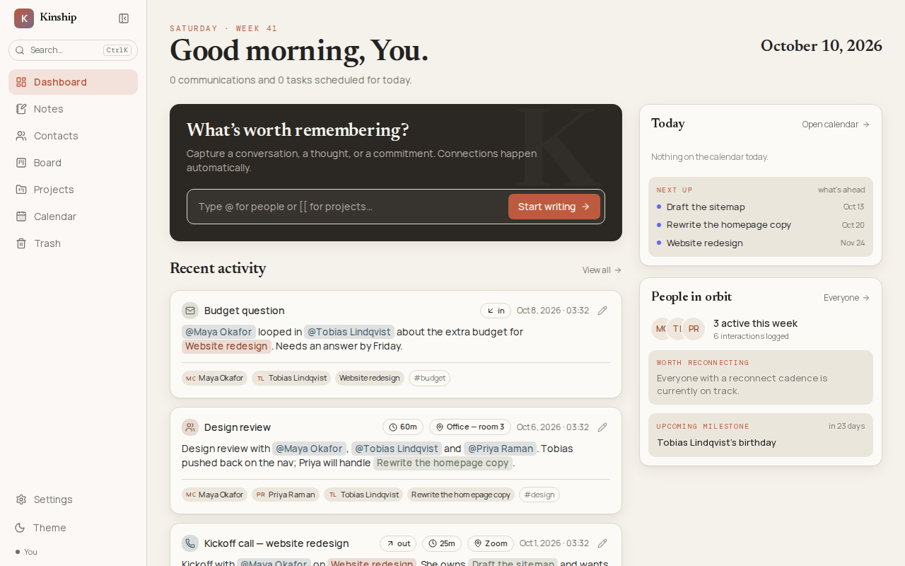
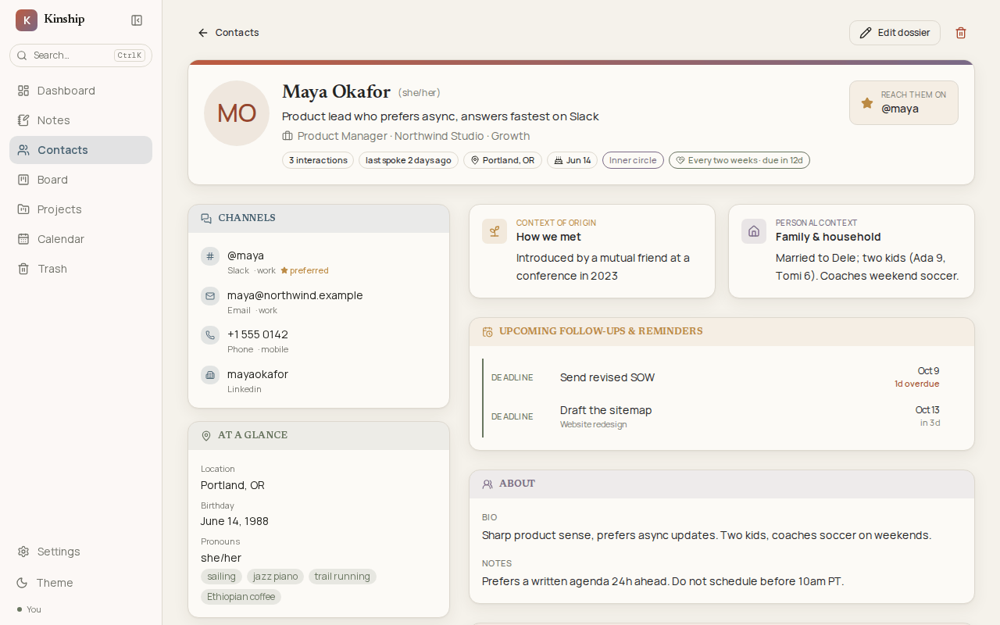
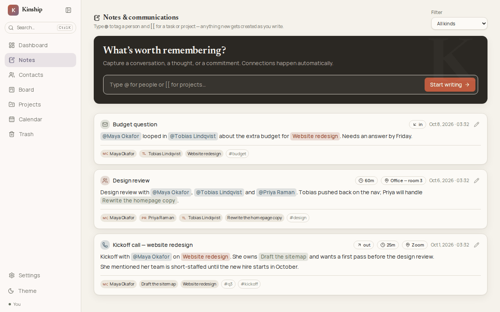
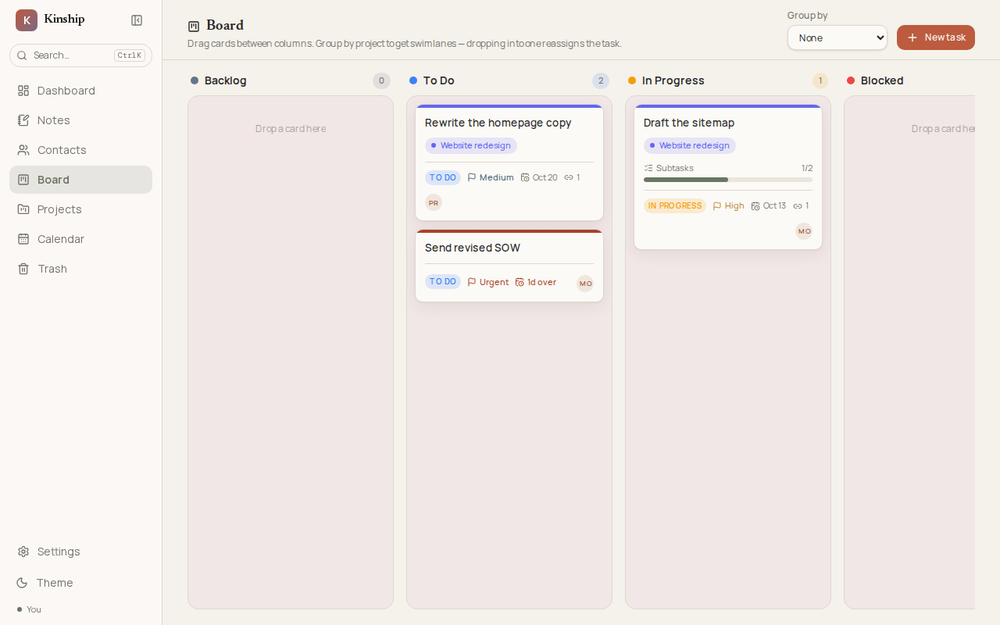
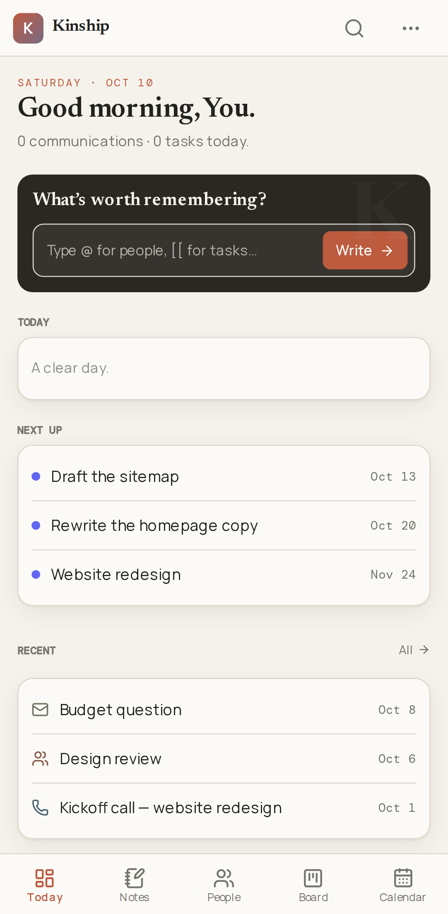
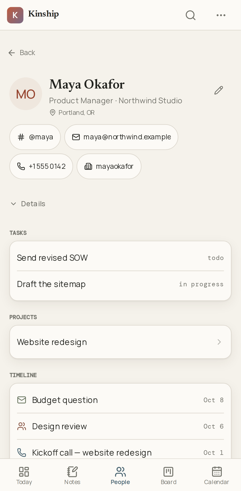

# Kinship

A self-hosted, single-user web app that keeps three things together that normally
live in separate tools:

- **Who you know**: contact dossiers with channels (and a preferred one), position
  history, milestones, links, personal context and notes
- **What was said**: notes, calls, emails, texts and meetings in one timeline
- **What's owed**: Kanban tasks, grouped into projects

The glue is **inline tagging**. You write naturally, type `@` to mention a person
and `[[` to reference a task or project. Tagging something that doesn't exist yet
creates it on the spot, and after you save, a short queue walks you through
filling in each new person, task or project, so capturing a thought is never
interrupted by data entry.

No cloud, no telemetry, no sign-in. Kinship is for one person on their own
computer: everything is stored under the single owner named by `KINSHIP_OWNER`.

> **Never expose Kinship to a network.** It has no sign-in, so anyone who can
> reach it can read and change everything in it. It listens on `127.0.0.1` only;
> keep it that way, and don't put it behind a reverse proxy or a tunnel.



| A contact | Notes and communications |
|---|---|
|  |  |

| The board | On a phone |
|---|---|
|  |   |

All of it is the demo data from `npm run db:seed`; none of these people exist.

---

## Quick start

You need [Docker](https://docs.docker.com/get-docker/) with the Compose plugin
(`docker compose`) and git, on a 64-bit Intel or AMD computer (Linux, or Windows
or macOS with Docker Desktop). The published image is built for that kind of
computer only; on any other, such as an Apple silicon Mac or a Raspberry Pi,
[build it from source](#build-from-source).

```bash
git clone https://github.com/NoProfessional582/kinship.git
cd kinship
cp .env.example .env
```

Open `.env` and fill in the two required settings (see [Settings](#settings)):

```bash
POSTGRES_PASSWORD=   # letters and digits; `openssl rand -hex 24` makes a good one
KINSHIP_OWNER=me     # any fixed name; keep it once you start
```

Then start it:

```bash
docker compose up -d
```

The first start downloads Kinship's image,
`ghcr.io/noprofessional582/kinship`, and the PostgreSQL image. When
`docker compose ps` shows `db` and `web` as healthy, open
**http://127.0.0.1:3000**. (`migrate` is a one-shot job: it sets up the database,
then exits, so it isn't listed.)

To look around with some demo people, notes and tasks first:

```bash
docker compose run --rm migrate npm run db:seed
```

The seed only fills an empty database; it does nothing once you have contacts.

Stop Kinship with `docker compose down`. Your data stays in `./data` and is
there again on the next `docker compose up -d`.

### Build from source

The image is built from this repo's `Dockerfile`, and compose can build it
instead of downloading it:

```bash
docker compose up -d --build
```

The build takes a few minutes. It is tagged with the same name as the published
image, so later `docker compose up -d` runs use your build until a newer version
is downloaded. If the image cannot be downloaded at all (no network, or a version
that is not published yet), `docker compose up -d` builds it by itself.

## Settings

All settings live in `.env`, next to `compose.yaml`.

| Setting | Required | What it does |
|---|---|---|
| `POSTGRES_PASSWORD` | yes | Password for Kinship's own database. Use letters and digits only: it goes into a connection string as-is. The database keeps the password it was created with, so set it before the first start (to change it later, see below). |
| `KINSHIP_OWNER` | yes | The single owner's name, for example `me`. Every record is stored under it, so changing it later hides your existing data rather than moving it. Kinship refuses to start without it. |
| `KINSHIP_PORT` | no | The port Kinship answers on, on this computer only. Default `3000`. It is always bound to `127.0.0.1`. |

Kinship validates the request's Host and public port before serving owner data.
Browser writes must come from the same origin (including the port); foreign or
null origins are refused with 403. JSON routes require `Content-Type:
application/json` (415 otherwise), and photo uploads require multipart form
data. Originless command-line requests still work on an allowed local host;
the archive `curl` examples below already send the required JSON type.

The default allowed origins are `http://127.0.0.1:3000` and
`http://localhost:3000`, using `KINSHIP_PORT` when it is set. Compose passes
that public port into the app even though its internal port stays 3000.
Advanced development/test runners can set `KINSHIP_ALLOWED_ORIGINS` to a
comma-separated list of exact HTTP origins, replacing those defaults. It does
not support wildcards or make network exposure safe. The container health
probe alone may use `http://127.0.0.1:3000/api/health` at the internal port.

Time zones need no setting: times show in your browser's zone, or in the zone you
pick under **Settings → Timezone**. The containers run on UTC on purpose.

To change the database password after the first start, change it inside the
database too, then restart:

```bash
docker compose exec db psql -U kinship -d kinship -c "ALTER USER kinship PASSWORD 'new-password'"
# put the same value in .env as POSTGRES_PASSWORD, then:
docker compose up -d
```

## Where your data lives

| Folder | Holds |
|---|---|
| `data/postgres` | the database |
| `data/uploads` | contact photos |

Both belong to the containers' users, not to you, so reading or deleting them
directly needs `sudo`. `docker compose down` never touches them. Deleting
`data/` (with Kinship stopped) deletes everything.

**Your data is never in git.** `data/` and archives are in `.gitignore`. Pushing
code and backing up data are two separate habits.

## Backups and restores

The simplest backup is an **archive**: one JSON file holding every record and
every contact photo. Photos sit on disk rather than in the database, so a
database-only backup would leave them behind.

### Make an archive

From the `kinship` folder:

```bash
docker compose run --rm -T migrate npm run --silent export > kinship-archive-$(date +%F).json
```

`--silent` and `-T` keep npm's banner and terminal control characters out of the
file. Or use **Settings → Data → Download archive** in the browser.

### Restore an archive

**A restore replaces everything** stored under your `KINSHIP_OWNER` with the
archive's contents. Look first, then restore:

```bash
# says what it would replace, changes nothing
docker compose run --rm -T migrate npm run --silent import < kinship-archive-2026-10-09.json

# does it
docker compose run --rm -T migrate npm run --silent import -- --replace < kinship-archive-2026-10-09.json

# hands the restored photos to the web server, which cannot save new ones until then
docker compose up -d
```

Or use **Settings → Data → Choose archive** in the browser, type `replace`, and
choose *Replace everything*.

Both sides have to be on the same database migrations. The archive records which
ones it was made with, and a restore that does not match refuses and names the
difference. Adding `--force` (or *Import anyway* in the browser) restores anyway:
columns added since the export take their defaults, and columns dropped since
are discarded.

### Over HTTP, from the same computer

The browser panel is a thin wrapper over two routes, and `curl` can drive them:

```bash
curl -sOJ http://127.0.0.1:3000/api/export     # saves the archive under its suggested name

curl -X POST 'http://127.0.0.1:3000/api/import?confirm=replace' \
     -H 'Content-Type: application/json' \
     --data-binary @kinship-archive-2026-10-09-12-00-00.json
```

`confirm=replace` is required and cannot be turned off: with no sign-in, the only
thing between a stray POST and all your data is that the caller had to spell out
what it was asking for. Add `&force=1` to waive the migration check.

### Moving to another computer

1. On the new computer, follow the [Quick start](#quick-start). The database it
   creates is empty but fully set up.
2. On the old computer, [make an archive](#make-an-archive) and copy the file
   across however you like.
3. On the new computer, [restore it](#restore-an-archive). Everything is stored
   under the new computer's `KINSHIP_OWNER`.
4. Check a contact with a photo and a search, and only then retire the old
   computer.

Do the restore on the **new** computer: nothing can tell which end of the move
you are on, and a restore replaces what it finds.

### Copying the data folder instead

A full copy of `data/` also works, as long as Kinship is stopped while you copy
it:

```bash
docker compose down
sudo tar -czf kinship-data-$(date +%F).tar.gz data
docker compose up -d
```

Restore it by stopping Kinship, replacing `data/` with the copy, and starting it
again. Unlike an archive, this only works with the same database version and the
same `KINSHIP_OWNER`.

## Upgrading

Each release is a git tag (`v0.1.0`) and an image with the same version
(`ghcr.io/noprofessional582/kinship:0.1.0`), named in `compose.yaml`. To upgrade,
take an archive first, then get the new `compose.yaml` and start it:

```bash
docker compose run --rm -T migrate npm run --silent export > kinship-archive-before-upgrade.json
git pull
docker compose up -d
docker compose logs migrate
```

`docker compose up -d` downloads the version the new `compose.yaml` names and
replaces the running app with it. If you build from source, use
`docker compose up -d --build` instead.

Database changes apply by themselves on every `docker compose up`, before the app
starts, and keep your data. The last command shows what was applied ("No pending migrations"
when nothing was). Read `CHANGELOG.md` before upgrading across a major version.

## Development

You need Node.js 24 and a Postgres you can reach. The compose stack does not
publish its database port, so for `npm run dev` use a Postgres of your own, with
`DATABASE_URL` and `KINSHIP_OWNER` in your environment or in `.env`.

```bash
npm ci
npm run dev          # http://127.0.0.1:3000
npm run typecheck
npm run lint
npm run format:check # npm run format rewrites what it flags
npm test             # unit tests, no database needed
```

The integration tests need a database and the whole toolchain, which the
released image leaves out. `scripts/test-stack.sh` runs them in a throwaway stack
of its own (see [Checks](#checks)). To run them against a database of your own,
with `DATABASE_URL` set as for `npm run dev`:

```bash
npm run test:integration
```

They create and remove their own records under throwaway owners, but run them
against a development copy, not the database holding your real data.

### Checks

`scripts/check.sh` runs every check a change needs before it is merged, and stops at
the first failure. It runs from any checkout of the repo, starts nothing that it does
not remove again, pass or fail, and ends with each part's time:

```bash
scripts/check.sh --list          # the parts
scripts/check.sh                 # every part, in order
scripts/check.sh quick privacy   # only those parts
```

- `quick`: Prettier, ESLint (no warnings allowed), the type check, the unit tests,
  `npm audit` (no high or critical advisories), and that compose publishes ports on
  `127.0.0.1` only.
- `privacy`: gitleaks on the branch's commits and on the working tree, and a sweep of
  the files and the branch's commits (authors and messages too) for personal data.
- `stack` (`scripts/test-stack.sh`): builds the image and runs it in a throwaway stack
  with its own database, no published port and no way out. It checks health and logs,
  then runs the database tests, the command-line jobs (seed, export, import, LinkedIn
  import) and the Playwright tests: API tests for every route, every page and the main
  flows on a desktop and on a phone, and importing archives, old ones included.
- `upgrade` (`scripts/test-upgrade.sh`): the previous version (the newest `vX.Y.Z` tag,
  or `origin/main` until there is one) makes a database and uploads a photo; this
  version then migrates it and runs on it. Shared/trashed photo references and an untracked legacy orphan are included; repeated restores must preserve physical image names and hashes while excluding the orphan from exports. Every table must keep its rows and the photo
  its bytes, and every page must load. `scripts/test-upgrade.sh REF` starts from another
  version.

The computer running them needs bash 4 or later, git, Docker with Compose and Buildx,
and [gitleaks](https://github.com/gitleaks/gitleaks). Node.js runs in the Dockerfile's
own image through `scripts/node.sh`, so it does not need to be installed. A full run
takes about five minutes, most of it in `stack`; the first run downloads the images
and takes longer.

The personal-data sweep reads a list of what must never be published (names, email
addresses, domains) from `~/.config/kinship/private-patterns.txt`, or from the file
`KINSHIP_PRIVATE_PATTERNS` names. It holds one Perl regular expression per line, with
`(?i)` in front where case does not matter; blank lines and lines starting with `#` are
skipped. It stays outside the repo, since committing it would publish what it guards.
`KINSHIP_PRIVATE_PATTERNS=none` skips the sweep.

When a Playwright test fails, its trace is kept in `test-results/`; open it with
`npx playwright show-trace test-results/<test>/trace.zip`.

`scripts/screenshots.sh` remakes the pictures at the top of this file from the demo
data, in a throwaway stack of its own (`tests/screenshots/`). Look at them before
committing them.

### Architecture

| Layer | Choice |
|---|---|
| Framework | Next.js 16.3 App Router, `output: 'standalone'` |
| UI | React 19.2, Tailwind CSS v4, Radix primitives |
| Data | Prisma 7.10 and PostgreSQL 18 (through `@prisma/adapter-pg`) |
| Editor | TipTap 3.31 with two `@tiptap/suggestion` instances |
| Drag and drop | dnd-kit |
| Calendar | FullCalendar 6.1.21 |

`compose.yaml` runs three services: `db` (Postgres), `migrate` (a one-shot job
that applies migrations, then exits) and `web` (the app), which starts only after
`migrate` has finished successfully.

### One pinning hazard

**FullCalendar must stay at 6.1.21 across every package.** `core` and `react`
publish a 7.x `latest`, but `daygrid`, `timegrid`, `list` and `interaction` do
not, and FullCalendar fails at runtime on mixed versions.

### How inline tagging works

`@` and `[[` are two configured `@tiptap/suggestion` instances sharing one
dropdown (`components/editor/suggestion-list.tsx`). Choosing "create" inserts a
node with a **provisional id** (`new:<uuid>`), rendered with a dashed underline.

On save, `lib/services/entries.ts` runs one transaction that:

1. creates each pending entity as a real row with `isDraft: true`
2. **rewrites every provisional id in the document body to the real id**
3. inserts the entry, its mentions and its refs
4. moves `lastContactAt` forward (never backward) for mentioned contacts

Doing the rewrite on the server, *inside* the transaction, is what guarantees a
failed save leaves no orphan contacts and no body pointing at rolled-back rows.
`tests/entries.integration.test.ts` asserts exactly that.

Typing `@Sarah` twice and choosing "create" both times reuses the same
provisional id (one contact, two mentions) by reading it back off the document,
which stays correct across undo, redo and paste.

### Contact dossier

Communication channels are one repeatable table discriminated by `ChannelType`
(phone, email, Slack, Teams, LinkedIn, other) rather than a table per medium, so
adding a channel is data rather than a migration. At most one channel per contact
carries `isPreferred`, enforced in the service rather than by a constraint.

Positions are the source of truth for what someone does now: the one flagged
`isCurrent` is what `company` and `jobTitle` on Contact are derived from on every
write. Those columns stay denormalized because the search vector, the contact
list and the mention dropdown all read them as single-table lookups.

### One measure, one rail, one board, one composer

Four things are deliberately singular, because each of them was once two:

- **Page width.** Every page sits on `--page-max` (`app/globals.css`).
- **The shell.** The sidebar is *inside* the centred block, not pinned to the
  window (`.kb-shell`, sized to `--page-max + --rail-w`), so on an ultrawide the
  app centres as one piece.
- **The board.** There is one set of `BoardColumn` rows, all with
  `projectId: null`; a project page is that board filtered to the project's
  cards. `BoardColumn.projectId` still exists in the schema, unused, so removing
  it needs no migration (see the search warning below for why that matters).
- **The composer.** `UnifiedComposer` renders the dark capture card everywhere,
  and both places share the draft under `kb.composer.hero`.

A `<select>` popup is painted by the browser from the control's own background
and colour, so the translucent field skin on the dark capture card came out as
white text on a white menu. `:root` and `.dark` declare `color-scheme`, and
`select option` gets an opaque background and colour explicitly.

### Event categories

`occurredAt` answers two different questions. On a note typed just now it is a
filing date; on a meeting next Tuesday it is an appointment.
`lib/calendar-categories.ts` is the single vocabulary, shared by the month grid,
the Today brief, the dashboard's Next up and the contact dossier:

| Category | What lands in it |
| --- | --- |
| `scheduled` | **Any** entry dated in the future, whatever its kind |
| `meeting` | A past meeting, call or in-person: it occupied a slot |
| `followup` | An entry's `followUpAt` |
| `deadline` | A task's due date, and a project's start and target dates |
| `milestone` | Birthdays and dated personal milestones |
| `log` | A past note, email, text or DM: a record, not an appointment |

`log` is the only category off by default on the calendar, and the only one the
day views never show. That module deliberately imports nothing: importing a
category name from a client component once pulled `pg` into the browser bundle.

### Dates and time zones

Every timestamp is stored in UTC (`timestamp without time zone`, written as UTC
by Prisma; both containers run UTC). Display is a separate concern, controlled
by `Settings.timezone`: empty means "follow the browser", while pinning a zone
matters when travelling.

The distinction that matters is **instants versus calendar dates**:

- *Instants* (`occurredAt`, `createdAt`, `lastContactAt`, `completedAt`) are
  moments on the world clock, rendered *in* a zone through `formatInstant`.
- *Calendar dates* (birthdays, position start and end, milestones, due dates) are
  days on a wall calendar, with no time and no zone. They go through
  `calendarDate`, which reads the year, month and day directly. Converting these
  between zones is exactly what once showed a June 14th birthday as the 13th.

The trap is a **calendar-day question about now** ("is this overdue", "is it
today"): `isPast`, `isToday` or `differenceInCalendarDays` against a bare
`new Date()` answer in the *browser's* zone. Use `useZonedToday()`, which returns
today as a local-midnight `Date`, the same shape `calendarDate` produces.

A `datetime-local` input has no zone at all, so both directions go through
`toLocalInputValue` and `fromLocalInputValue`. FullCalendar needs
`@fullcalendar/luxon3` to honour a named zone; without it, it silently falls back
to UTC.

Anything that depends on the runtime's time zone data (the list of zones, a
zone's current offset) is computed in the browser only: the server and the
browser can disagree, which breaks hydration.

### Full-text search

`Contact.searchVector` and `Entry.searchVector` are `GENERATED ALWAYS` tsvector
columns with GIN indexes, plus `pg_trgm` indexes for fuzzy name matching, so a
misspelled name still finds the right record. `array_to_string` is `STABLE`, not
immutable, so Postgres rejects it in a generated column; the migrations define a
narrow `kb_array_to_string(text[])` wrapper, which genuinely is immutable.

### `prisma migrate dev` will try to drop full-text search

Read this before generating a migration. The schema can only describe
`searchVector` as `Unsupported("tsvector")?`, so Prisma sees the column defaults,
the GIN indexes and the trigram indexes as **drift**, and every generated
migration begins by dropping them:

```sql
DROP INDEX "Contact_search_idx";
DROP INDEX "Entry_search_idx";
DROP INDEX "Contact_name_trgm_idx";      -- and Task_/Project_
ALTER TABLE "Contact" ALTER COLUMN "searchVector" DROP DEFAULT;   -- fails
```

The last statement errors (`column "searchVector" is a generated column`), so
the migration fails, but the `DROP INDEX`es ahead of it are **not** rolled back,
and neither is an `ALTER TYPE ... ADD VALUE`. That is how
`20260821194100_restore_search_indexes` came to exist.

So: run `npm run db:migrate:create -- --name <slug>` (which is
`prisma migrate dev --create-only` and needs a disposable `SHADOW_DATABASE_URL`),
delete everything from the generated SQL except the change you actually meant,
and only then apply it.

**This is enforced, not just advised.** `prisma/check-migrations.mjs` runs in the
`migrate` container ahead of `prisma migrate deploy`, so a migration that drops
either generated column, any of the custom indexes, the `kb_array_to_string`
function or the `pg_trgm` extension without putting it back in the same
migration is refused before anything is applied. Run it yourself with
`npm run db:migrate:check`. Enum additions want `ADD VALUE IF NOT EXISTS`, since
a retry after a failed migration otherwise hits `42710 enum label already
exists`. Afterwards, confirm the indexes are still there:

```bash
docker compose run --rm migrate \
  npx prisma db execute --stdin <<<"select indexname from pg_indexes \
    where indexname ilike '%search%' or indexname ilike '%trgm%';"
```

### The archive is three modules

`lib/archive-format.ts` is the wire contract: the format marker, the version, and
the shape of an import's answer. It imports nothing, because the settings page is
a client component and can have neither a database nor `node:fs` in its bundle.

`lib/archive-rows.ts` knows the schema: which tables in which foreign-key order,
which columns are instants, which task has to be written before which. It reads
its column lists from `Prisma.dmmf`, so a column added to the schema is exported
the day it lands, and it asserts that every model is accounted for. It is covered
by the unit suite (`tests/archive-rows.test.ts`).

`lib/services/archive.ts` knows the machine: it queries, deletes the owner's rows
and rebuilds them inside one transaction, and reads and writes the uploads
folder. Uploads are written under fresh names before the transaction opens, and
the restored contacts are pointed at them, so a failure part-way leaves the old
data and the old photos exactly as they were. The `searchVector` columns, the
indexes and the `_prisma_migrations` ledger are not in the archive: they belong
to the migrations, and Postgres rebuilds `searchVector` from the restored rows.

### Migrations

Migrations run in the one-shot `migrate` service, which `web` waits on
(`service_completed_successfully`). It runs the same image as `web`, from
`/app/cli`: the npm scripts, `prisma/`, `lib/` and only the packages the
command-line jobs use, the Prisma CLI and tsx among them
(`docker/cli-modules.mjs` picks them). The web server keeps its own
`node_modules` in `/app`, so neither can change the other's packages. Prisma 7 moved the database URL
out of `schema.prisma` into `prisma.config.ts` and no longer loads `.env` by
itself, which is why that file imports `dotenv/config`.

## License

[MIT](LICENSE)

### Task hierarchy inventory

`docker compose run --rm migrate npm run --silent tasks:check` prints a read-only JSON report of the configured owner's task-parent cycles, including trashed tasks. It does not repair links. Review affected task IDs and back up data before choosing an explicit repair. New task saves and archive restores reject cycles.

Calendar queries use an exclusive timed window end. All-day date ranges retain timezone widening and inclusive stored deadlines. Task/project spans are included throughout their duration. A legacy reversed span is not rewritten: its start remains selectable within the window.

Contact “last contacted” is derived from the latest live, already-happened entry mentioning that contact. Editing a date into the past or future, calendar rescheduling and changing follow-ups recompute it. The 0.1.2 migration repairs old cached values without altering source entries. Back up the database and uploads before upgrading an existing installation. Earlier code can still read the corrected dates; reverting code does not restore the original incorrect cache.

### Photo lifetime and read-only inventory

New uploads remain pending for seven days so an open editor can save them. Unassigned expired uploads are rejected on save; upload the photo again. A photo still referenced by any live or trashed contact stays valid. Clearing/replacing an avatar, permanent contact deletion and archive replacement record only the local references they actually remove, with one day of grace after the latest removal. Pending protection takes precedence over that grace.

Collection runs opportunistically after upload, contact save, purge/empty trash and archive replacement. It uses persistent owner-local pending/candidate journals and the same PostgreSQL owner lock as reference writes, imports and exports. It rechecks all live and trashed references before removing verified regular image files. No timer or legacy orphan sweep runs. Pending records persist whether the upload has ever been assigned; once assigned, expiry alone cannot authorize deletion. A later removal requires its own valid candidate record. Reuse cancels old candidate records before commit, so a later record failure cannot reuse an old deletion deadline. Assignment is journaled before commit, so a failed commit may conservatively retain an assigned orphan. A filesystem failure retains journals for retry and does not undo a committed database change. Invalid journals, symlinks and unknown files are conservatively retained. If journaling fails, an untracked file may be retained indefinitely.

`npm run photos:check` (in the packaged CLI: `cd /app/cli && npm run photos:check`) prints a **read-only**, configured-owner inventory: scan timestamp, safe filenames, bytes, age in milliseconds, live/trashed references, pending deadline and assignment state, candidate grace deadline, eligibility and totals. Unsafe files/journals, invalid row references and missing photos are reported separately. It never deletes or writes files or rows. Eligibility describes the new-operation policy; it is not a deletion command. This scan is a snapshot; files and references can change afterward. Do not run it against real data as part of tests.

Legacy orphan cleanup is a separate action: first verify a recoverable full database **and uploads** backup (an app export omits orphans), review a concrete file list and obtain approval, then revalidate all references, pending/grace state, confinement and regular-file identity immediately before each deletion. There is no legacy delete mode.
